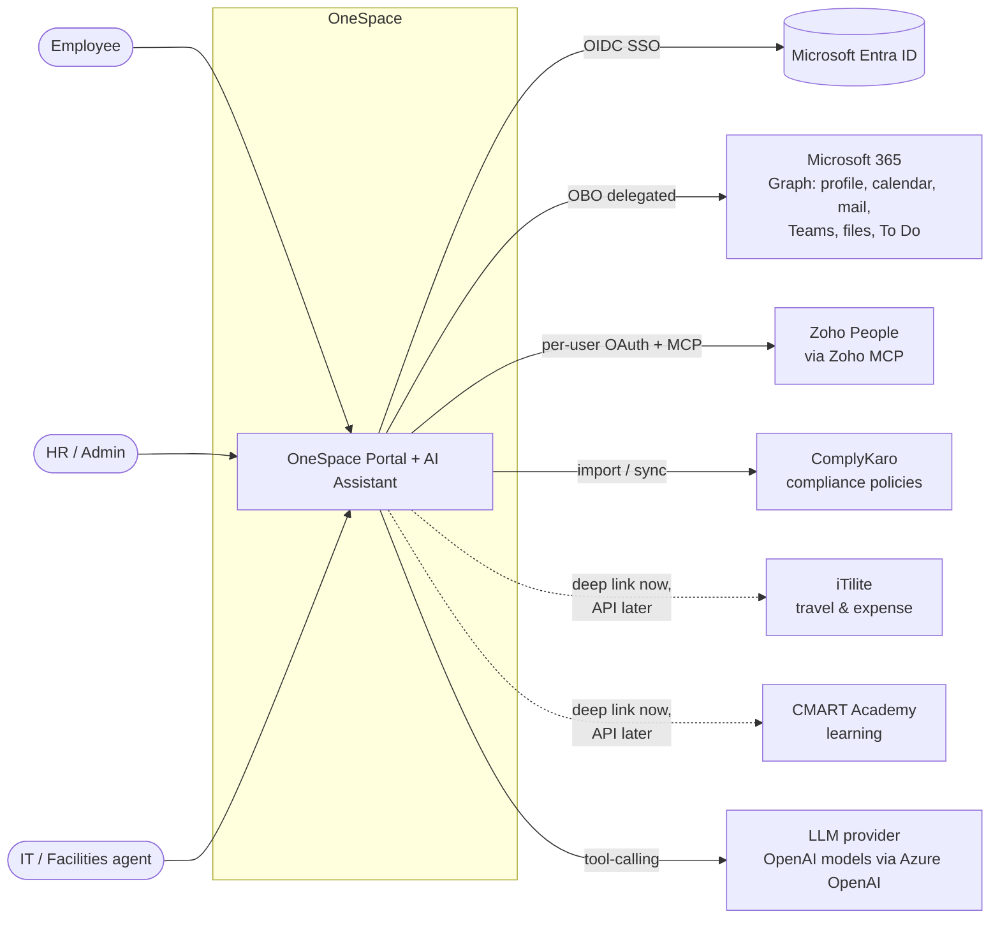
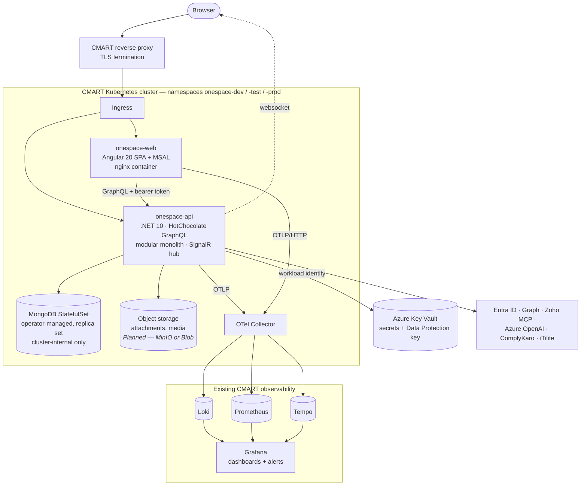
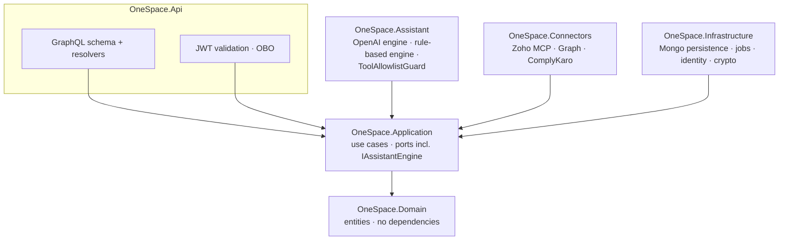
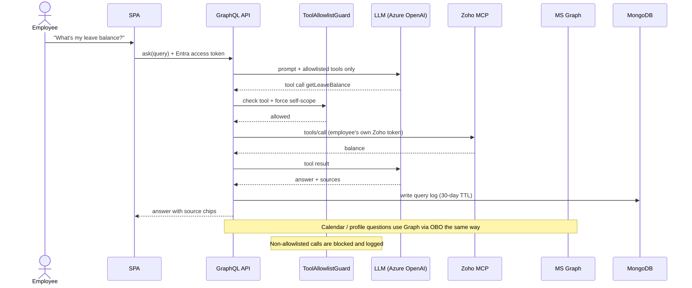
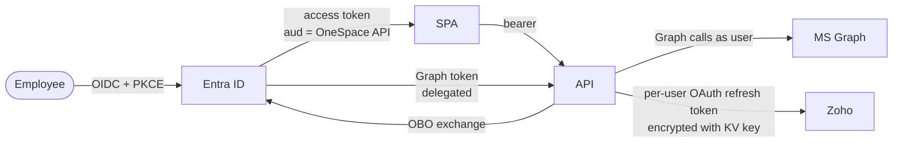
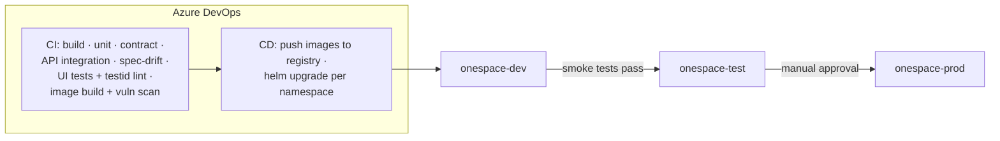
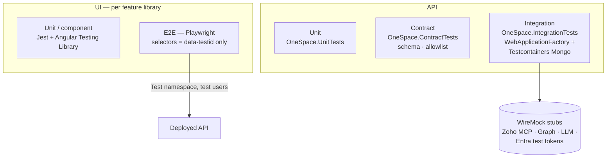

# OneSpace — Enterprise Architecture

| | |
|---|---|
| **Version** | 0.2 — Review comments from Rahul (2026-11-24) applied |
| **Date** | 2026-11-24 |
| **Reviewer** | Rahul (Enterprise Architect) |
| **Scope** | Phase 0 POC (as-built) → Production target (EP01–EP25) |
| **Related** | [PRD](OneSpace_PRD_MVP.md) · [Implementation plan](implementation-plan.md) · [ADRs](../adr/) · [Production plan](../planning/OneSpace_Production_Plan_ADO.csv) · [Minutes 2026-11-18](../planning/meetings/2026-11-18-onespace-meeting-minutes.md) |

Status labels used below: **Built** = in the repo today · **Planned** = in the production backlog · **Proposed** = needs a decision · **Agreed** = accepted in review.

---

## 0. Review outcome — Rahul, 2026-11-24

| # | Comment | Response in this version | Status |
|---|---|---|---|
| 1 | Monolith is fine; plan to release on Kubernetes | API and UI ship as containers to the CMART K8s cluster via Helm (§4, §9, [ADR 0005](../adr/0005-kubernetes-hosting.md)). App Service / Static Web App dropped | Agreed |
| 2 | Dedicated MongoDB or PostgreSQL on K8s (sensitive data, avoid cloud cost); Key Vault is fine | Self-hosted **MongoDB** on K8s recommended — the code already uses the Mongo driver and Testcontainers, so no persistence rewrite. PostgreSQL compared in [ADR 0005](../adr/0005-kubernetes-hosting.md). Cosmos DB dropped; Key Vault kept | Agreed — engine to confirm (§13) |
| 3 | Stack choice otherwise good | .NET 10 + HotChocolate GraphQL, Angular 20 unchanged | Agreed |
| 4 | Is micro-frontend over-complex? | Default changed to a **single Angular app with lazy-loaded, boundary-enforced feature libraries**; micro-frontends kept as a later option (§5a, [ADR 0004](../adr/0004-micro-frontends.md)) | For discussion |
| 5 | Server-side deny by default is good | Unchanged ([ADR 0003](../adr/0003-server-side-tool-allowlist.md)) | Agreed |
| 6 | Simplify network for POC: K8s cluster + existing reverse proxy | Front Door / WAF / private endpoints removed. Traffic via the shared CMART reverse proxy → K8s ingress; DB is cluster-internal only (§4, §7) | Agreed |
| 7 | Use a Copilot model or OpenAI instead of Claude | LLM provider switched to **OpenAI models** (Azure OpenAI recommended) behind the existing `IAssistantEngine` port ([ADR 0006](../adr/0006-llm-provider-openai.md)). "Copilot" meaning to confirm (§13) | Agreed — provider to confirm |
| 8 | Loki, Prometheus/Grafana, OTel with Tempo (existing infra) | App Insights / Log Analytics replaced by OpenTelemetry → OTel Collector → Loki · Prometheus · Tempo, dashboards and alerts in Grafana (§4, §10, [ADR 0007](../adr/0007-observability-lgtm.md)) | Agreed |

---

## 1. Purpose and business context

OneSpace is the employee "digital front door". It **integrates** existing systems of record (Zoho People, M365, ComplyKaro, iTilite, CMART Academy) behind one portal and an AI assistant. It does not replace them.

| Driver | Architectural consequence |
|---|---|
| 6–10 disconnected HR/IT tools | Integration layer + single UX shell, not a new system of record for HR data |
| HR, health and compliance data in one AI surface | Per-user delegated access (OBO), deny-by-default tool allowlist, audit trail; sensitive data kept in our own cluster |
| Small team (2 dev, 2 QA) | Modular monolith, one UI app, reuse the shared CMART K8s platform, one pipeline |
| Phased roadmap (Assistant → Feed/Helpdesk → engagement) | Module boundaries that can be extracted later without breaking the API contract |

## 2. Architecture principles

1. **Integrate, don't duplicate.** Query systems of record at request time. Cache only non-sensitive or static content (policies).
2. **User identity end to end.** Every downstream call runs as the signed-in employee (Entra OBO / per-user OAuth). No shared service accounts for user data.
3. **Deny by default for AI actions.** The LLM can only call allowlisted, read-only tools, enforced server-side ([ADR 0003](../adr/0003-server-side-tool-allowlist.md)).
4. **Spec-driven contracts.** GraphQL schema, MCP allowlist and feature specs in `specs/` are the source of truth; CI fails on drift.
5. **Shared platform, low cloud cost.** Run on the CMART Kubernetes platform and its existing reverse proxy and observability stack; use managed cloud services only where they add clear value (Key Vault, LLM). Everything as code (Helm + Bicep for the few Azure resources); secrets only in Key Vault.
6. **Modular monolith first** for the API ([ADR 0001](../adr/0001-modular-monolith.md)); split only when scale or team size demands it.
7. **Simple UI first.** One Angular app with strictly separated, lazy-loaded feature libraries; move to micro-frontends only if independent team releases become a real bottleneck (§5a).

## 3. System context (C4 level 1)

## 4. Containers (C4 level 2)

| Container | Technology | Status |
|---|---|---|
| UI | Angular 20 (standalone, signals), MSAL, GraphQL codegen — one app, nginx image | Built (container image Planned) |
| API | .NET 10, HotChocolate 16, one Deployment (2+ replicas in prod) | Built (container image Planned) |
| Database | MongoDB (Community / Percona operator) StatefulSet, 3-node replica set in prod, PVC-backed, scheduled backups ([ADR 0005](../adr/0005-kubernetes-hosting.md)) | Agreed |
| Secrets | Azure Key Vault, accessed via workload identity (AKS) or External Secrets Operator (other clusters) | Built (KV) · Planned (K8s access) |
| Real-time | SignalR in the API (Redis backplane when > 1 replica) instead of Azure Web PubSub | Planned |
| Object storage | MinIO in-cluster or Azure Blob — **to confirm** | Planned |
| Observability | OpenTelemetry SDK → OTel Collector → Loki / Prometheus / Tempo / Grafana ([ADR 0007](../adr/0007-observability-lgtm.md)) | Agreed (today: Azure Monitor OTel exporter) |
| Edge | Existing CMART reverse proxy + K8s ingress | Agreed |

## 5. API internal structure (C4 level 3)

Dependencies point inward: `Application` owns the ports, adapters live in `Connectors` / `Infrastructure` / `Assistant`. Swapping Claude for OpenAI is a new `IAssistantEngine` adapter; the guard, tools and GraphQL contract do not change. New business modules (Feed, Helpdesk, Ideas, Kudos, HR Policies …) are added as vertical slices in `Application` + `Domain` with their own Mongo collections, exposed via the one GraphQL schema.

## 5a. Frontend architecture

Rahul's question: are micro-frontends over-complex for this app? With 2 developers today, **yes for now**. Revised default:

| Option | What it is | When |
|---|---|---|
| **A. Modular single app (default)** | One Angular app in an Nx workspace. Each business area is a lazy-loaded feature library (`ui/libs/feature-assistant`, `feature-feed`, `feature-policies` …) with Nx module-boundary lint rules — no imports between features, only via shared libs. One build, one image, one release | Now, while one team owns the UI |
| B. Micro-frontends ([ADR 0004](../adr/0004-micro-frontends.md)) | Shell + independently deployed remotes via Native Federation and a runtime manifest | Only if several teams need independent UI releases |

Option A keeps the door open: because features are already isolated libraries with route-level entry points, a feature can later be turned into a remote without rewriting it.

| Concern | Rule (option A) |
|---|---|
| **Ownership** | CODEOWNERS per `ui/libs/feature-*` folder |
| **Boundaries** | Features expose only their `Routes`; cross-feature imports blocked by Nx `enforce-module-boundaries` |
| **Shared code** | `@onespace/ui-kit` (design system, EP03), `auth` (MSAL), `graphql` (Apollo + codegen) as shared libs |
| **Data** | Each feature owns a GraphQL module in `specs/graphql`; spec-drift check per module |
| **Auth** | MSAL in the `auth` lib only; one app registration |
| **Release** | One pipeline; feature flags (per Entra group) to pilot a module with one team |
| **Testing** | Unit + component tests per feature lib; E2E on the app in Test. All components carry `data-testid` per §10a |

## 6. Key flow — AI assistant query

## 7. Identity and security

| Control | Implementation | Status |
|---|---|---|
| SSO | Entra ID OIDC, MSAL in SPA, JWT validation in API | Built |
| Delegated downstream access | Graph OBO; Zoho per-employee OAuth (PKCE), refresh tokens encrypted via ASP.NET Data Protection wrapped by a Key Vault key | Built |
| AI tool safety | Server-side allowlist (6 Zoho read tools), identity args overwritten, contract tests | Built |
| Authorization / roles | Entra app roles (Employee, HR Admin, Agent, Content Admin) → GraphQL policies | Planned (EP02) |
| Secrets | Key Vault; pods get access via workload identity / External Secrets Operator; no secrets in images, Helm values or config maps | Built (KV) · Planned (K8s) |
| Network (POC) | CMART reverse proxy (TLS) → ingress; MongoDB and Collector are ClusterIP only; K8s NetworkPolicies restrict pod-to-pod traffic; egress only to Entra, Graph, Zoho, Azure OpenAI, Key Vault | Agreed |
| Network (prod) | Re-assess WAF need at the reverse proxy before go-live | Proposed |
| Audit | Query log today; immutable audit store required before benefits/health data (PazCare) | Planned |
| Data protection | TLS 1.2+; MongoDB encryption at rest (encrypted storage class / volume encryption); HR data stays in our cluster; LLM via Azure OpenAI with no training on customer data, region **to confirm** | Proposed |

## 8. Data architecture

| Domain | Store | System of record | Sensitivity |
|---|---|---|---|
| Leave, profile, holidays | Not stored — live query | Zoho People | HR / PII |
| Calendar, mail, files, Teams | Not stored — live query | Microsoft 365 | PII |
| Compliance policies | MongoDB (cached, text search; vector search later) | ComplyKaro | Internal |
| HR policies (authored in OneSpace) | MongoDB (block JSON + versions) + object storage (attachments) | **OneSpace** | Internal |
| Feed, ideas, kudos, polls, helpdesk, bookings, chat | MongoDB + object storage | OneSpace | Internal / PII |
| Query log | MongoDB, 30-day TTL | OneSpace | PII |
| Zoho refresh tokens | MongoDB, encrypted | OneSpace | Secret |

Rule: OneSpace becomes system of record **only** for content it authors (feed, ideas, HR policies, tickets). HR transactional data stays in source systems.

Self-hosted MongoDB obligations (previously handled by Cosmos): replica set for HA, daily backups + point-in-time recovery to off-cluster storage, tested restore, version upgrades, monitoring via Prometheus exporter. Vector search for the assistant knowledge base: MongoDB 8.2+ search (`mongot`) — maturity **to verify**; text index is enough for Phase 0.

## 9. Deployment and environments

- One Helm chart (`.deploy/helm/onespace`) with per-environment values files; images tagged by commit SHA in the CMART container registry (**to confirm**).
- Rolling updates; readiness `/health/ready`, liveness `/health/live`; HPA on the API in prod.
- Bicep kept only for the Azure resources still used (Key Vault, Azure OpenAI). App Service, Static Web App, Cosmos and App Insights modules removed from `.deploy/infra/main.bicep`.
- Phase 0 posture: single MongoDB node, one API replica. **Prod target:** 3-node replica set, 2+ API replicas, backups verified.

## 10. Non-functional targets

| Area | Target |
|---|---|
| Latency | < 3 s real-time queries (excl. LLM), < 1 s indexed search |
| Availability | Phase 0 best effort · Prod target 99.9% (**to confirm**) — bounded by the shared cluster's SLA |
| Scale | Load-tested at 20 concurrent users (POC); prod sizing **to confirm** with headcount |
| Quality gates | ≥ 70% coverage on new code, green contract + spec-drift + API integration tests, `data-testid` lint clean (§10a) |
| Observability | OTel traces in Tempo, metrics in Prometheus, logs in Loki correlated by trace ID; Grafana alerts on 5xx, latency, blocked tool calls, LLM errors/cost, MongoDB health |

## 10a. Test architecture

### UI — automation test IDs (mandatory)

Every interactive or asserted UI element carries a stable `data-testid`. E2E and component tests select **only** by `data-testid` (or ARIA role) — never by CSS class, text or DOM position.

| Rule | Detail |
|---|---|
| **Scope** | All `@onespace/ui-kit` components and every feature component: buttons, links, inputs, selects, toggles, tabs, dialogs, menus, cards, list/table rows, empty/error/loading states, toasts, source chips |
| **Format** | `<feature>-<component>-<element>[-<qualifier>]`, kebab-case. E.g. `assistant-chat-input`, `assistant-chat-send-btn`, `assistant-answer-source-chip-0`, `shell-nav-feed`, `policies-editor-publish-btn` |
| **Lists / repeaters** | Container ID + per-item suffix from a stable key (`feed-post-card-{postId}`), not the index, where a key exists |
| **ui-kit support** | Each ui-kit component accepts a `testId` input and renders it as `data-testid` on its root and key parts (`{testId}-input`, `{testId}-error`) |
| **Uniqueness** | Unique within a rendered page; IDs are part of the feature's public contract — renaming one is a breaking change for QA |
| **Production** | Attributes kept in prod builds (enables synthetic monitoring); contain no PII or data values |
| **Enforcement** | ESLint rule (`@angular-eslint/template` custom rule) fails CI when an interactive element lacks `data-testid`; PR checklist + Definition of Done item |
| **Registry** | Each feature library exports its IDs as constants in `testids.ts`, shared with Playwright page objects to avoid string drift |

Status: **Planned** — not yet applied to the current SPA; retrofit alongside the Nx/ui-kit extraction.

### API — integration testing

| Layer | Scope | Tooling | Status |
|---|---|---|---|
| Unit | Domain, use cases, `ToolAllowlistGuard` | xUnit | Built |
| Contract | GraphQL schema vs. `specs/`, MCP allowlist, spec drift | xUnit, snapshot | Built |
| **Integration** | Full HTTP pipeline: auth → GraphQL → Application → Mongo / connectors | `WebApplicationFactory` + Testcontainers MongoDB | Built (extend) |
| E2E / smoke | Deployed Test namespace through UI + API | Playwright, `/health` | Planned |

Integration test rules:

1. **Real infrastructure, fake externals.** Real Mongo (Testcontainers, same major version as the cluster); Zoho MCP, Graph, the LLM and ComplyKaro replaced by WireMock/in-process fakes behind the existing ports. No calls to live third parties in CI.
2. **Auth in the loop.** Tests issue signed test JWTs (test issuer/keys) so authorization policies, role checks and OBO paths run for real; include negative cases (no token, wrong role, other user's data).
3. **Every GraphQL operation** in `specs/graphql` has at least one happy-path and one failure-path integration test; coverage tracked per module.
4. **Assistant safety.** Scripted LLM fake returns non-allowlisted / cross-user tool calls; tests assert they are blocked, identity args overwritten and the event logged. Same suite runs against every `IAssistantEngine` adapter.
5. **Isolation.** Fresh database per test class; deterministic clock and IDs; tests run in parallel.
6. **Per module.** Each new vertical slice (Feed, Helpdesk, Policies …) ships its integration tests in the same PR; CODEOWNERS matches the module.
7. **Pipeline.** Run on every PR (Docker-enabled ADO agent); failure blocks merge. Nightly run against the deployed Test namespace with test users.

## 11. Items from 2026-11-18 meeting — architectural fit

| Item | Proposed approach | Status |
|---|---|---|
| **HR policies with a Notion-like editor** (Yashna) | New `Policies` module. Block editor in SPA (TipTap or BlockNote — both MIT, Angular-compatible). Store blocks as JSON with versioning, draft/publish workflow, HR Admin role, read acknowledgement. Published policies are indexed into the assistant's knowledge base. | Proposed (EP21) |
| **Onboarding page for freshers** | Content page built on the same block editor + checklist (tasks) and links; audience targeted by Entra group / join date from Zoho. | Proposed |
| **Placeholder links: Zoho, iTilite, CMART Academy** | Config-driven "Apps" launcher (title, URL, icon, audience) stored in MongoDB, editable by admins. SSO deep links now; API integration later (EP22, EP24). | Proposed |
| **"What's Next" / new updates** | Feed card type "Product update" in Company Feed (EP04), driven by admin posts. | Proposed |

## 12. Architecture decisions

| ADR | Decision | Status |
|---|---|---|
| [0001](../adr/0001-modular-monolith.md) | Modular monolith | Accepted — now deployed on K8s |
| [0002](../adr/0002-cosmos-db-mongo-vcore.md) | Cosmos DB for MongoDB vCore | Superseded by 0005 |
| [0003](../adr/0003-server-side-tool-allowlist.md) | Server-side, deny-by-default tool allowlist | Accepted |
| [0004](../adr/0004-micro-frontends.md) | Micro-frontend UI (shell + remotes) | Deferred — modular single app first |
| [0005](../adr/0005-kubernetes-hosting.md) | Kubernetes hosting + self-hosted MongoDB | Proposed (agreed in review) |
| [0006](../adr/0006-llm-provider-openai.md) | OpenAI models (Azure OpenAI) as LLM provider | Proposed (agreed in review) |
| [0007](../adr/0007-observability-lgtm.md) | OTel + Loki / Prometheus / Tempo / Grafana | Proposed (agreed in review) |

## 13. Open questions for Rahul

Resolved in review: monolith on K8s (1), network posture for POC (6), stack (3).

1. **Database engine.** Confirm MongoDB over PostgreSQL (no persistence rewrite; see [ADR 0005](../adr/0005-kubernetes-hosting.md)). Does the platform team already run a MongoDB operator, or should OneSpace own it?
2. **Cluster.** Which cluster (AKS or on-prem), container registry, ingress class, storage class and backup target to use? Is GitOps (Argo CD / Flux) used for other apps?
3. **"Copilot model".** Options: Azure OpenAI (recommended — same GPT model family as Copilot, enterprise data terms, region choice) or the OpenAI API. GitHub Copilot is not licensed as a backend for other apps; Microsoft 365 Copilot would mean building OneSpace as a Copilot agent and needs Copilot licences for every user.
4. **Data residency and LLM data handling.** Azure OpenAI region and approval for sending HR data to it.
5. **Micro-frontends.** Agree option A (modular single app) for now and the trigger for revisiting option B.
6. **Audit store.** Immutable audit trail (append-only collection vs. Loki with retention lock) before PazCare.
7. **Rich-text editor.** TipTap vs. BlockNote for HR policies / onboarding content.
8. **ComplyKaro.** No public API found — approve document import or SharePoint as the policy source.
9. **Availability / DR targets** for production (SLA, RPO, RTO), given the shared cluster and self-hosted DB.

## 14. Risks

| Risk | Mitigation |
|---|---|
| Zoho MCP supports only server credentials | Guard enforces self-scope; identity args overwritten |
| Prompt injection via tool output | Allowlist enforced server-side; blocked calls logged and alerted |
| ComplyKaro has no content API | Pluggable `IComplyKaroSource`; manual import fallback |
| LLM latency / cost | Small/mini model for routing, ≤ 5 tool rounds, token budgets alerted in Grafana, rule-based fallback engine |
| Tool-calling behaviour differs after switching LLM | Same guard and contract/integration suite run against the new engine before cut-over; Claude engine kept until parity |
| Self-hosted MongoDB operations (HA, backup, upgrades) on a 2-dev team | Operator-managed replica set, automated backups with monthly restore test, platform team ownership agreed up front |
| Shared cluster capacity / noisy neighbours | Resource requests/limits, namespace quotas, HPA |
| Scope growth (25 epics) on a small team | Phased delivery; modular boundaries keep features independent |
| Brittle UI automation as features evolve | Mandatory `data-testid` convention, lint gate, shared `testids.ts` registry (§10a) |
| Integration tests miss real third-party behaviour | Fakes recorded from real responses; nightly run against Test namespace with test users |
| Inconsistent UX across features | Mandatory `@onespace/ui-kit`, shared layout, design review in Definition of Done |
