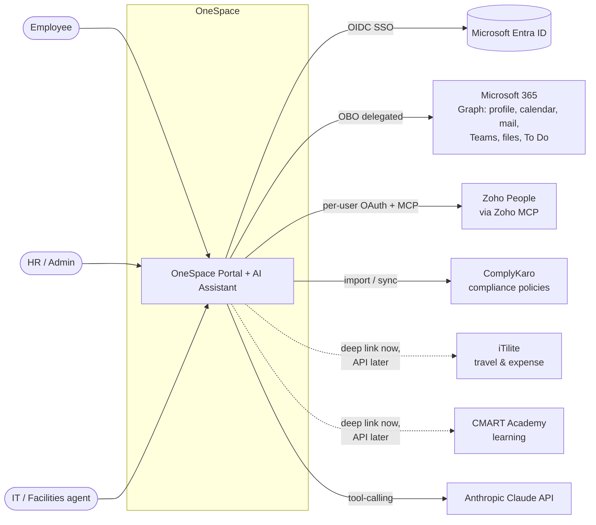
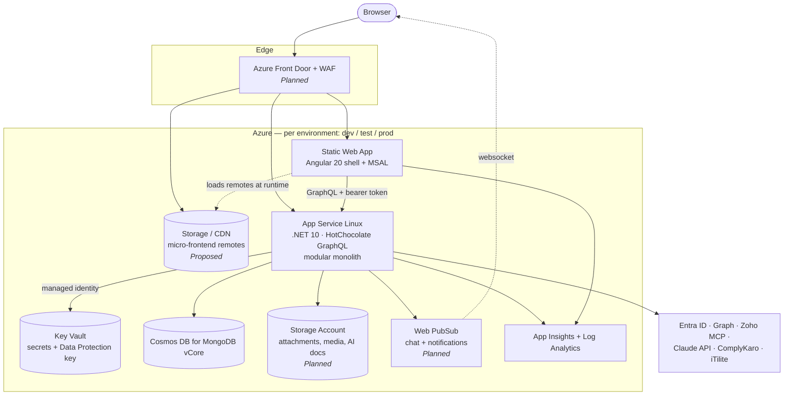
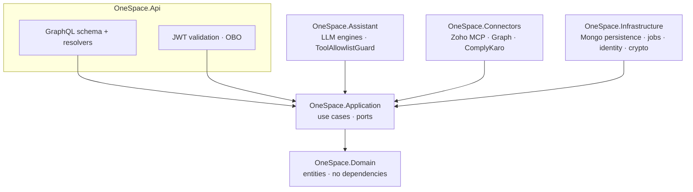
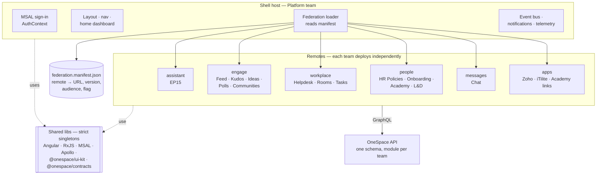
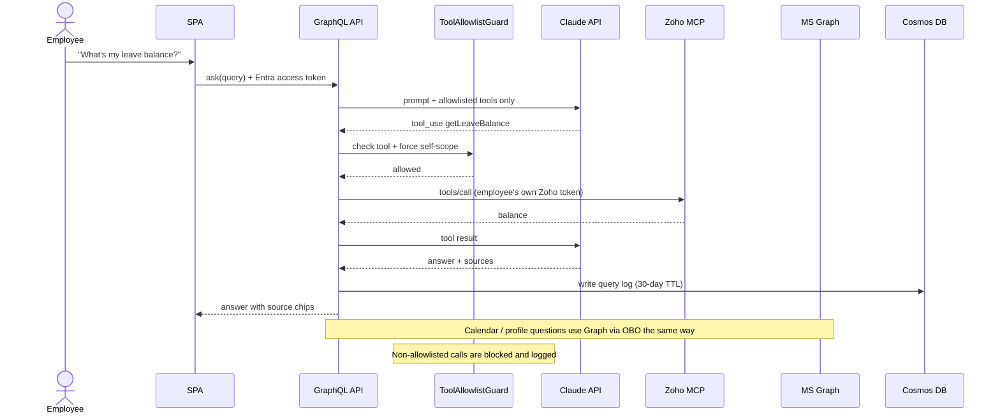
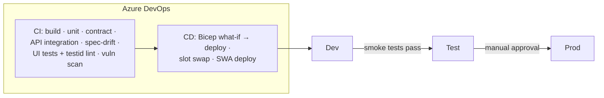
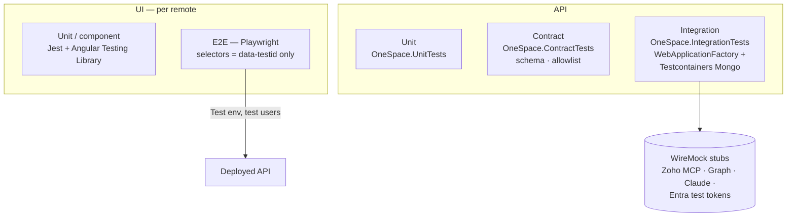

# OneSpace — Enterprise Architecture

| | |
|---|---|
| **Version** | 0.1 — Draft for architecture review |
| **Date** | 2026-11-19 |
| **Reviewer** | Rahul (Enterprise Architect) |
| **Scope** | Phase 0 POC (as-built) → Production target (EP01–EP25) |
| **Related** | [PRD](OneSpace_PRD_MVP.md) · [Implementation plan](implementation-plan.md) · [ADRs](../adr/) · [Production plan](../planning/OneSpace_Production_Plan_ADO.csv) · [Minutes 2026-11-18](../planning/meetings/2026-11-18-onespace-meeting-minutes.md) |

Status labels used below: **Built** = in the repo today · **Planned** = in the production backlog · **Proposed** = needs a decision in this review.

---

## 1. Purpose and business context

OneSpace is the employee "digital front door". It **integrates** existing systems of record (Zoho People, M365, ComplyKaro, iTilite, CMART Academy) behind one portal and an AI assistant. It does not replace them.

| Driver | Architectural consequence |
|---|---|
| 6–10 disconnected HR/IT tools | Integration layer + single UX shell, not a new system of record for HR data |
| HR, health and compliance data in one AI surface | Per-user delegated access (OBO), deny-by-default tool allowlist, audit trail |
| Small team (2 dev, 2 QA) | Modular monolith, PaaS only, one pipeline |
| Phased roadmap (Assistant → Feed/Helpdesk → engagement) | Module boundaries that can be extracted later without breaking the API contract |

## 2. Architecture principles

1. **Integrate, don't duplicate.** Query systems of record at request time. Cache only non-sensitive or static content (policies).
2. **User identity end to end.** Every downstream call runs as the signed-in employee (Entra OBO / per-user OAuth). No shared service accounts for user data.
3. **Deny by default for AI actions.** The LLM can only call allowlisted, read-only tools, enforced server-side ([ADR 0003](../adr/0003-server-side-tool-allowlist.md)).
4. **Spec-driven contracts.** GraphQL schema, MCP allowlist and feature specs in `specs/` are the source of truth; CI fails on drift.
5. **PaaS and IaC only.** All Azure resources from Bicep; secrets only in Key Vault via managed identity.
6. **Modular monolith first** for the API ([ADR 0001](../adr/0001-modular-monolith.md)); split only when scale or team size demands it.
7. **Team-owned UI modules.** The UI is a shell plus independently deployed micro-frontends, so small teams build and release their own modules ([ADR 0004](../adr/0004-micro-frontends.md), §5a).

## 3. System context (C4 level 1)

## 4. Containers (C4 level 2)

| Container | Technology | Status |
|---|---|---|
| SPA | Angular 20 (standalone, signals), MSAL, GraphQL codegen — single app | Built |
| UI shell + micro-frontend remotes | Native Federation, Nx monorepo, runtime manifest | Proposed ([ADR 0004](../adr/0004-micro-frontends.md)) |
| API | .NET 10, HotChocolate 16, single App Service | Built |
| Database | Cosmos DB for MongoDB vCore ([ADR 0002](../adr/0002-cosmos-db-mongo-vcore.md)) | Built (Bicep not yet deployed) |
| Secrets | Key Vault, RBAC, purge protection, MI access | Built |
| Observability | App Insights + Log Analytics | Built |
| Blob storage, Web PubSub, Front Door/WAF, VNet + private endpoints | Azure PaaS | Planned (EP01) |

## 5. API internal structure (C4 level 3)

Dependencies point inward: `Application` owns the ports, adapters live in `Connectors` / `Infrastructure` / `Assistant`. New business modules (Feed, Helpdesk, Ideas, Kudos, HR Policies …) are added as vertical slices in `Application` + `Domain` with their own Mongo collections, exposed via the one GraphQL schema.

## 5a. Frontend architecture — micro-frontends (Proposed)

Goal: small teams own a business area end to end and release its UI on their own, without a shared release train. See [ADR 0004](../adr/0004-micro-frontends.md).

| Concern | Rule |
|---|---|
| **Ownership** | One remote per team / business area; CODEOWNERS per `ui/apps/<remote>` folder |
| **Integration contract** | Remote exposes `Routes`; shell mounts it at `/<remote>`. Remotes use shell services (`AuthContext`, `UserContext`, `Navigation`) and the event bus. No direct imports between remotes (lint-enforced) |
| **Shared dependencies** | Angular, RxJS, MSAL, Apollo, ui-kit shared as strict-version singletons; Angular major upgrades coordinated by the Platform team |
| **UX consistency** | All UI built with `@onespace/ui-kit` (design system, EP03); shell owns header, nav, theming, accessibility baseline |
| **Data** | Each remote owns a GraphQL module in `specs/graphql`; spec-drift check per module; codegen per remote |
| **Auth** | Only the shell talks to MSAL; remotes receive tokens through the shared Apollo client — no per-remote app registrations |
| **Release** | Nx monorepo, path-filtered pipeline per app. Remote deployed to versioned path `/remotes/<name>/<version>/`; going live = manifest update (instant rollback by reverting the entry) |
| **Targeting** | Manifest entries can be limited to an audience (Entra group) or feature flag → pilot a module with one team first |
| **Resilience** | Shell shows a fallback card if a remote fails to load; one broken remote never blocks the portal |
| **Security** | CSP allow-lists only the remotes origin; remotes served via Front Door; SRI/integrity checked in pipeline |
| **Testing** | Unit + component tests per remote; contract test that each remote builds against the current shell contracts; E2E smoke on the composed app in Test. All components carry `data-testid` per §10a |

**Migration from today's single app** (low risk, incremental):
1. Move `ui/` into an Nx workspace; extract `ui-kit`, `auth`, `graphql` into libs (no behaviour change).
2. Turn the current app into the shell; add Native Federation host config and the manifest loader.
3. Extract the Assistant feature as the first remote; prove independent deploy and rollback.
4. New epics (HR Policies, Feed, Helpdesk …) start as remotes from day one.

## 6. Key flow — AI assistant query

## 7. Identity and security

| Control | Implementation | Status |
|---|---|---|
| SSO | Entra ID OIDC, MSAL in SPA, JWT validation in API | Built |
| Delegated downstream access | Graph OBO; Zoho per-employee OAuth (PKCE), refresh tokens encrypted via ASP.NET Data Protection wrapped by a Key Vault key | Built |
| AI tool safety | Server-side allowlist (6 Zoho read tools), identity args overwritten, contract tests | Built |
| Authorization / roles | Entra app roles (Employee, HR Admin, Agent, Content Admin) → GraphQL policies | Planned (EP02) |
| Secrets | Key Vault + managed identity; no secrets in config | Built |
| Network | Front Door WAF, VNet integration, private endpoints for Cosmos/KV, public access off | Planned (EP01) |
| Audit | Query log today; immutable audit store required before benefits/health data (PazCare) | Planned |
| Data protection | TLS 1.2+, encryption at rest (platform), data residency region **to confirm** | Proposed |

## 8. Data architecture

| Domain | Store | System of record | Sensitivity |
|---|---|---|---|
| Leave, profile, holidays | Not stored — live query | Zoho People | HR / PII |
| Calendar, mail, files, Teams | Not stored — live query | Microsoft 365 | PII |
| Compliance policies | Cosmos (cached, text/vector search) | ComplyKaro | Internal |
| HR policies (authored in OneSpace) | Cosmos (block JSON + versions) + Blob (attachments) | **OneSpace** | Internal |
| Feed, ideas, kudos, polls, helpdesk, bookings, chat | Cosmos + Blob | OneSpace | Internal / PII |
| Query log | Cosmos, 30-day TTL | OneSpace | PII |
| Zoho refresh tokens | Cosmos, encrypted | OneSpace | Secret |

Rule: OneSpace becomes system of record **only** for content it authors (feed, ideas, HR policies, tickets). HR transactional data stays in source systems.

## 9. Deployment and environments

- Identical Bicep per environment with `.bicepparam` overrides; resource naming `onespace-{env}-*`.
- API: App Service with staging slot and swap; health check `/health`.
- Phase 0 posture: no HA on Cosmos, public network access enabled. **Prod target:** HA on, private endpoints, WAF.

## 10. Non-functional targets

| Area | Target |
|---|---|
| Latency | < 3 s real-time queries (excl. LLM), < 1 s indexed search |
| Availability | Phase 0 best effort · Prod target 99.9% (**to confirm**) |
| Scale | Load-tested at 20 concurrent users (POC); prod sizing **to confirm** with headcount |
| Quality gates | ≥ 70% coverage on new code, green contract + spec-drift + API integration tests, `data-testid` lint clean (§10a) |
| Observability | Distributed tracing, alerts on 5xx, latency, blocked tool calls |

## 10a. Test architecture

### UI — automation test IDs (mandatory)

Every interactive or asserted UI element carries a stable `data-testid`. E2E and component tests select **only** by `data-testid` (or ARIA role) — never by CSS class, text or DOM position.

| Rule | Detail |
|---|---|
| **Scope** | All `@onespace/ui-kit` components and every feature component: buttons, links, inputs, selects, toggles, tabs, dialogs, menus, cards, list/table rows, empty/error/loading states, toasts, source chips |
| **Format** | `<remote>-<feature>-<element>[-<qualifier>]`, kebab-case. E.g. `assistant-chat-input`, `assistant-chat-send-btn`, `assistant-answer-source-chip-0`, `shell-nav-feed`, `policies-editor-publish-btn` |
| **Lists / repeaters** | Container ID + per-item suffix from a stable key (`feed-post-card-{postId}`), not the index, where a key exists |
| **ui-kit support** | Each ui-kit component accepts a `testId` input and renders it as `data-testid` on its root and key parts (`{testId}-input`, `{testId}-error`) |
| **Uniqueness** | Unique within a rendered page; IDs are part of the remote's public contract — renaming one is a breaking change for QA |
| **Production** | Attributes kept in prod builds (enables synthetic monitoring); contain no PII or data values |
| **Enforcement** | ESLint rule (`@angular-eslint/template` custom rule) fails CI when an interactive element lacks `data-testid`; PR checklist + Definition of Done item |
| **Registry** | Each remote exports its IDs as constants in `testids.ts`, shared with Playwright page objects to avoid string drift |

Status: **Planned** — not yet applied to the current SPA; retrofit alongside the Nx/ui-kit extraction (§5a step 1).

### API — integration testing

| Layer | Scope | Tooling | Status |
|---|---|---|---|
| Unit | Domain, use cases, `ToolAllowlistGuard` | xUnit | Built |
| Contract | GraphQL schema vs. `specs/`, MCP allowlist, spec drift | xUnit, snapshot | Built |
| **Integration** | Full HTTP pipeline: auth → GraphQL → Application → Mongo / connectors | `WebApplicationFactory` + Testcontainers MongoDB | Built (extend) |
| E2E / smoke | Deployed Test env through UI + API | Playwright, `/health` | Planned |

Integration test rules:

1. **Real infrastructure, fake externals.** Real Mongo (Testcontainers); Zoho MCP, Graph, Claude and ComplyKaro replaced by WireMock/in-process fakes behind the existing ports. No calls to live third parties in CI.
2. **Auth in the loop.** Tests issue signed test JWTs (test issuer/keys) so authorization policies, role checks and OBO paths run for real; include negative cases (no token, wrong role, other user's data).
3. **Every GraphQL operation** in `specs/graphql` has at least one happy-path and one failure-path integration test; coverage tracked per module.
4. **Assistant safety.** Scripted LLM fake returns non-allowlisted / cross-user tool calls; tests assert they are blocked, identity args overwritten and the event logged.
5. **Isolation.** Fresh database per test class; deterministic clock and IDs; tests run in parallel.
6. **Per module.** Each new vertical slice (Feed, Helpdesk, Policies …) ships its integration tests in the same PR; CODEOWNERS matches the module.
7. **Pipeline.** Run on every PR (Docker-enabled ADO agent); failure blocks merge. Nightly run against the deployed Test environment with test users.

## 11. Items from 2026-11-18 meeting — architectural fit

| Item | Proposed approach | Status |
|---|---|---|
| **HR policies with a Notion-like editor** (Yashna) | New `Policies` module. Block editor in SPA (TipTap or BlockNote — both MIT, Angular-compatible). Store blocks as JSON with versioning, draft/publish workflow, HR Admin role, read acknowledgement. Published policies are indexed into the assistant's knowledge base. | Proposed (EP21) |
| **Onboarding page for freshers** | Content page built on the same block editor + checklist (tasks) and links; audience targeted by Entra group / join date from Zoho. | Proposed |
| **Placeholder links: Zoho, iTilite, CMART Academy** | Config-driven "Apps" launcher (title, URL, icon, audience) stored in Cosmos, editable by admins. SSO deep links now; API integration later (EP22, EP24). | Proposed |
| **"What's Next" / new updates** | Feed card type "Product update" in Company Feed (EP04), driven by admin posts. | Proposed |

## 12. Architecture decisions

| ADR | Decision | Status |
|---|---|---|
| [0001](../adr/0001-modular-monolith.md) | Modular monolith on one App Service | Accepted |
| [0002](../adr/0002-cosmos-db-mongo-vcore.md) | Cosmos DB for MongoDB vCore | Accepted |
| [0003](../adr/0003-server-side-tool-allowlist.md) | Server-side, deny-by-default tool allowlist | Accepted |
| [0004](../adr/0004-micro-frontends.md) | Micro-frontend UI (shell + remotes, Native Federation) | Proposed |

## 13. Decisions requested from Rahul

1. **Monolith → services threshold.** Agree the trigger (team size, independent scaling of chat/real-time) for extracting modules.
2. **Network posture for prod.** Front Door + WAF + private endpoints as in §4 — accept, or align with an existing CMART hub-spoke landing zone?
3. **Data residency and LLM data handling.** Region choice and approval for sending HR data to the Claude API (zero-retention terms).
4. **Audit store.** Design for an immutable audit trail (e.g. append-only collection vs. Log Analytics / Purview) before PazCare.
5. **Rich-text editor.** TipTap vs. BlockNote for HR policies / onboarding content (licensing, accessibility).
6. **ComplyKaro.** No public API found — approve document import or SharePoint as the policy source.
7. **Availability / DR targets** for production (SLA, RPO, RTO).
8. **Micro-frontends ([ADR 0004](../adr/0004-micro-frontends.md)).** Approve shell + remotes with Native Federation, the proposed team/remote split in §5a, and whether the API should later move to per-team GraphQL subgraphs (HotChocolate Fusion).

## 14. Risks

| Risk | Mitigation |
|---|---|
| Zoho MCP supports only server credentials | Guard enforces self-scope; identity args overwritten |
| Prompt injection via tool output | Allowlist enforced server-side; blocked calls logged and alerted |
| ComplyKaro has no content API | Pluggable `IComplyKaroSource`; manual import fallback |
| LLM latency / cost | Low effort setting, ≤ 5 tool rounds, rule-based fallback engine |
| Scope growth (25 epics) on a small team | Phased delivery; modular boundaries keep features independent |
| Micro-frontend version skew / shared-dependency drift | Strict singleton versions, contract tests per remote, Platform-owned upgrade cadence, manifest rollback |
| Brittle UI automation as remotes evolve | Mandatory `data-testid` convention, lint gate, shared `testids.ts` registry (§10a) |
| Integration tests miss real third-party behaviour | Fakes recorded from real responses; nightly run against Test env with test users |
| Inconsistent UX across team-built remotes | Mandatory `@onespace/ui-kit`, shell-owned layout, design review in Definition of Done |
